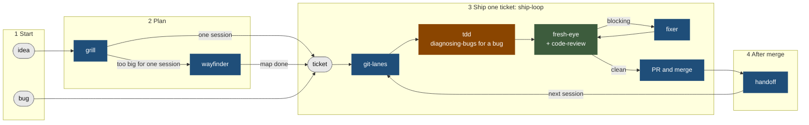

# yw-workflow

Twelve skills and seven hooks that make an engineering workflow mechanical
instead of remembered.

## Install

Pick one. Both serve the same twelve skills, and installing both leaves
duplicates that drift apart.

```bash
# skills only
npx skills add emmanuelwunjc/yw-workflow -g --skill '*' -y

# skills and the seven hooks. Use this on your own machine.
claude plugin marketplace add emmanuelwunjc/yw-workflow
claude plugin install yw-workflow@yw-workflow
```

Then restart Claude Code.

Both read the **default branch**, so a change is installable only once it
reaches `main`. The `-g` above is load-bearing: the skills CLI defaults to
project level and would write into whatever directory you are standing in.

A few skills mention "your CLAUDE.md". They read fine without one, and better
with the rules in it.


## Workflow

yw-workflow is made to sit beside [Matt Pocock's skills](https://github.com/mattpocock/skills).
His `tdd`, `diagnosing-bugs` and `code-review` check the work inside the loop.
These skills plan it, isolate it, review it, merge it, and carry it to the
next session. Blue boxes are yw-workflow. Brown boxes are mattpocock-skills,
called as `/mattpocock-skills:<name>`. Call the blue ones as
`/yw-workflow:<name>`, because Matt has his own `handoff` and `wayfinder`. The green box uses one skill from each
set. Every arrow is a hand-off that a skill names today.



How to read it, one stage at a time:

1. **Start.** Work arrives as an idea or a bug.
2. **Plan.** An idea goes to `grill`, one decision at a time. Work sized for
   one session goes straight to `ship-loop`. Work too big for one session goes
   to `wayfinder`, which maps it as decision tickets and hands the finished
   map to `ship-loop`. The model cannot call the yw `wayfinder`, so type
   `/yw-workflow:wayfinder`. Open ticket [#45](https://github.com/emmanuelwunjc/yw-workflow/issues/45) will replace it with
   Matt's copy.
3. **Ship one ticket.** `ship-loop` runs each ticket around one loop.
   `git-lanes` gives the agent its own worktree when others may share the
   repo. A change to behavior is written test first with `tdd`. A bug starts with
   `diagnosing-bugs`, which finds one command that fails first. `fresh-eye`
   sends a reviewer who did not write it, and that reviewer runs
   `code-review`. Blocking findings go to a `fixer` agent, and the fix gets a
   new review. After a clean review, the lane merges (`git-lanes`). Its PR
   body records each review (`ship-loop` step 6).
4. **After merge.** `handoff` writes what the next session needs, and the
   next session starts from it.

Matt's `implement`, `implement-spec`, `to-tickets`, `triage` and `retro` have
no hand-off from these skills yet. Open tickets [#42](https://github.com/emmanuelwunjc/yw-workflow/issues/42) (`triage`) and
[#43](https://github.com/emmanuelwunjc/yw-workflow/issues/43) (the other four) add hand-off lines or
rules for them.

Skills for any stage:

| Skill | Set | Use it when |
|---|---|---|
| `harden` | yw | A repo has no CI or branch protection yet. |
| `need-me` | yw | You want only what waits on you. |
| `pm` | yw | You want status, or one chat that runs the agents. |
| `mutation-gate` | yw | A check must prove it can fail. |
| `eli5`, `eli5-text` | yw | A topic needs the plain version. |
| `wait-what` | matt | The last message did not land. |
| `domain-modeling` | matt | A term needs one meaning in `GLOSSARY.md`. |
| `prototype` | matt | A question needs code to answer it. |

## Skills

Each one carries a one-line summary at the top.

| | |
|---|---|
| **grill** | Asks you one decision at a time, in checkboxes, until nothing is left to guess. |
| **wayfinder** | Turns work too big for one session into a map of decisions on GitHub Issues. |
| **git-lanes** | Gives every concurrent agent its own worktree so they cannot corrupt each other. |
| **ship-loop** | Runs work as a loop that closes: ticket, branch, test first, review, fix, repeat. |
| **fresh-eye** | Sends someone who did not write the code to try to break it. |
| **need-me** | Shows only what is waiting on you, answerable in one word. |
| **harden** | Gives a repo the CI and branch protection that make its review gate real. |
| **mutation-gate** | Proves each self-check can fail, by breaking the code it covers and requiring it to notice. |
| **handoff** | Keeps `docs/HANDOFF.md` and the `lane` issues in the shape that lets a fresh session start from them alone. |
| **eli5** | Explains a topic to someone with zero background, as a page of big pictures and few words. |
| **eli5-text** | Explains a topic to someone with zero background, in the conversation, with nothing to open. |
| **pm** | Gives you one chat that reports status and runs builder and reviewer agents, through Orca when it is installed and subagents when not. |

Invoke them namespaced: `/yw-workflow:grill`.

## Hooks

Each exists because a rule broke and prose was not enough. They come with the
plugin path only. The full rules, the CI gate and the config are in
[`docs/HOOKS.md`](docs/HOOKS.md).

| | | |
|---|---|---|
| **git-safety-guard.sh** | PreToolUse, `git *` | Blocks commits straight to `main` and tree moves that collide with another agent. |
| **require-code-review.py** | PreToolUse | Blocks `gh pr merge <number>` when a PR changes 25+ lines of code files (e.g. `.py`, `.sh`, `.yml`) and has no review. Override: `export SKIP_REVIEW_GATE=1;` in front of the command. |
| **no-ai-attribution.py** | PreToolUse | Keeps AI-generation footers out of anything people read. |
| **zsh-trap-guard.py** | PreToolUse | Blocks zsh traps in Bash commands, e.g. `$s:refs` (write `${s}:refs`). |
| **claude-md-guard.py** | UserPromptSubmit, Stop | Blocks em-dashes, negation-then-correction, and prose questions where checkboxes are required. |
| **handoff-freshness.py** | Stop | Warns when a session commits real work and never touches `docs/HANDOFF.md`. On a lane, it reminds you to write `## Handoff notes` in the PR body. Override: `SKIP_HANDOFF_CHECK=1`. |
| **context-handoff.py** | PostToolBatch, UserPromptSubmit, Stop | Winds a session down past about 120k tokens of context, and has it write the handoff. |

Wire them in one place only. Wiring a hook here and in
`~/.claude/settings.json` fires it twice.

## Checks

```bash
(for t in ./hooks/*-selftest.*; do "$t" || exit 1; done)
./tools/check-repo.py
```

Both run in CI on every pull request and on push to `main`, and `main` is
protected, so a red check blocks the merge for the repo owner too.

`claude-md-guard.py` is deliberately partial. It blocks a turn, so it fires only
when it is sure, and its known misses and known false positives are both listed
in its self-test.


## Role agents

A helper started without an agent type shows as `general-purpose` in Claude
Code, whatever it does. The plugin ships four named types, so the label tells
you the job.

| Type | Job |
|---|---|
| `yw-workflow:builder` | Builds one ticket, test first. |
| `yw-workflow:reviewer` | Reviews a change it did not write. It has no Write or Edit tool, and it keeps Bash to run tests. |
| `yw-workflow:fixer` | Fixes the blocking findings from a review. |
| `yw-workflow:documenter` | Writes docs and handoff notes from the code. |

`ship-loop` and `fresh-eye` name these types when they dispatch. The types ship
in the plugin install. Whether the `npx skills add` route carries them is not
verified. `tools/check-repo.py` fails when no skill mentions an agent's type,
when an agent lists a tool its role does not allow, and when a skill names a
type with no file. It matches text, so it cannot tell a real dispatch from a
mention in a comment.


## Credit

`grill` and `wayfinder` are adapted from
[Matt Pocock's skills](https://github.com/mattpocock/skills) (MIT). `wayfinder`
in particular is his design: the map issue, decision tickets sized to one
session, the fog of war, one ticket per session. Each skill's own Credit
section says what changed and why, and `NOTICE` reproduces his copyright and
permission notice in full, which is what MIT actually requires.


## Layout

- `agents/` one file per role agent.
- `skills/` one directory per skill, one `SKILL.md` each.
- `hooks/` the guards, their self-tests, and `hooks.json`.
- `.github/actions/guards/` the composite action that runs the guards in CI.
- `tools/check-repo.py` what the self-tests do not cover.
- `docs/HOOKS.md` each hook's full rules, the CI gate, and the config.
- `docs/HANDOFF.md` why decisions went the way they did, and the traps.
- `docs/DECISIONS.md` the dated measurements behind the skills.

Edit here, commit, then `claude plugin update yw-workflow`. A version bump is
required, because the update keys off it.
